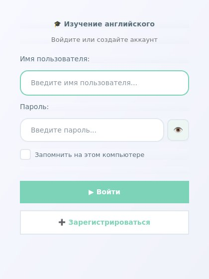
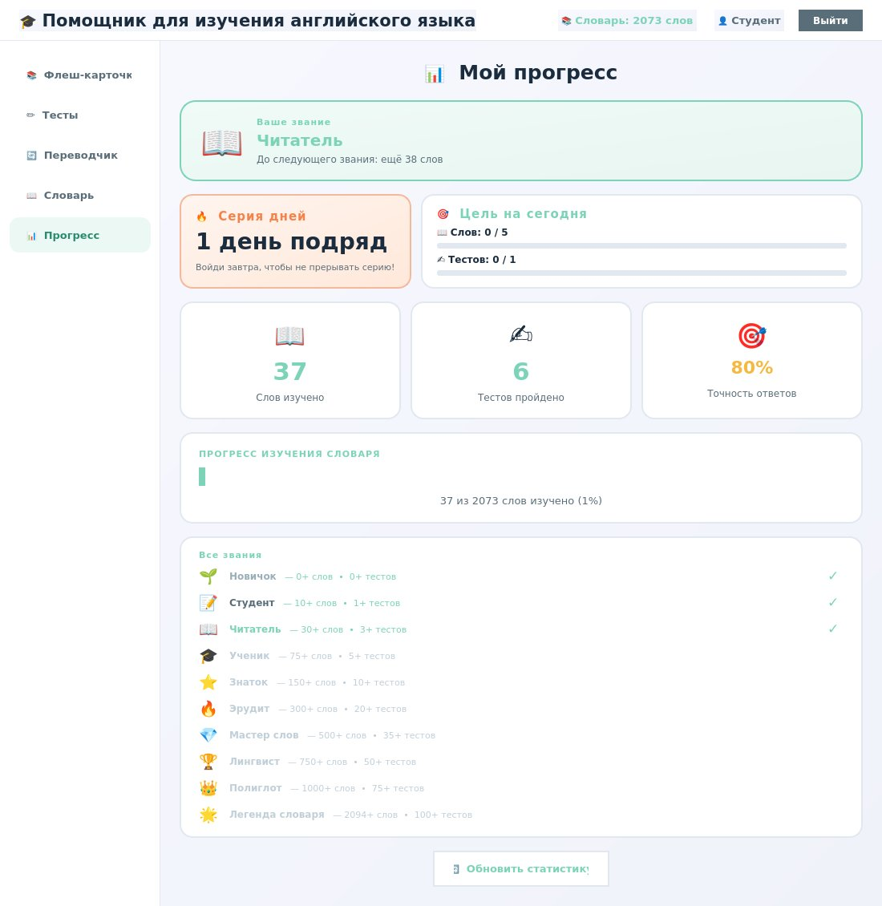
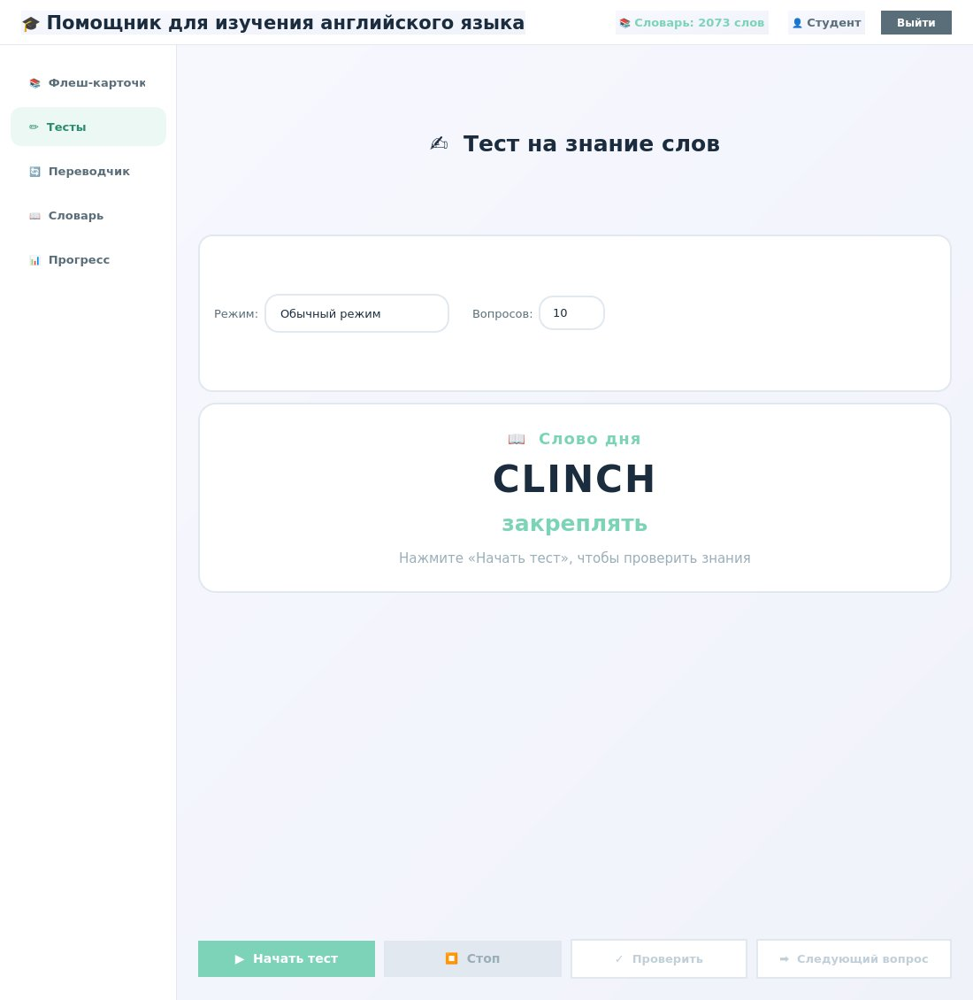
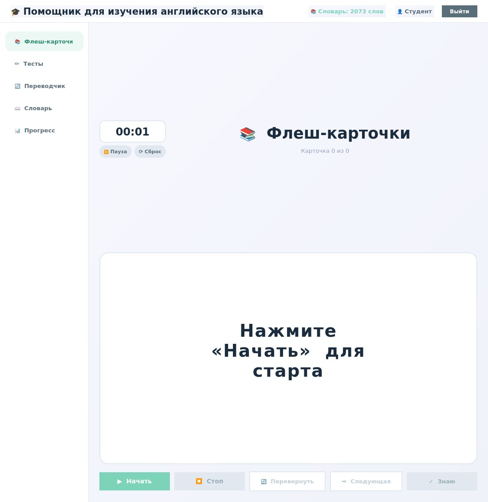
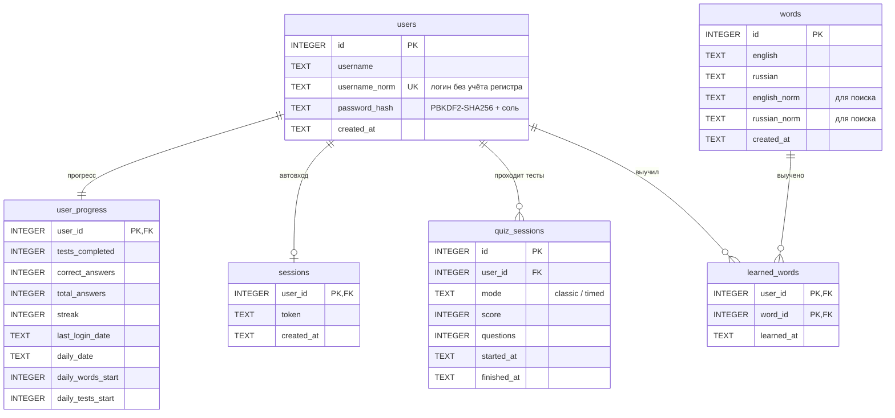

# Тренажёр английских слов

Настольное приложение для изучения английской лексики: флеш-карточки, тесты, переводчик, личный словарь и статистика прогресса.
Написано на **Python 3** с графическим интерфейсом на **PyQt5**. Все данные хранятся в базе **SQLite**.

<p align="center">
  
  &nbsp;
  
</p>

## Возможности

| Раздел | Что умеет |
|---|---|
| **Вход и регистрация** | Несколько пользователей, у каждого свой прогресс. Пароли хранятся только в виде хеша. «Запомнить на этом компьютере» — автовход при следующем запуске |
| **Флеш-карточки** | Слово → перевод по нажатию, кнопка «Знаю» отмечает слово выученным, таймер занятия |
| **Тесты** | Обычный режим (выбор числа вопросов) и режим «На время» (60 секунд). Слово дня. Результат каждого теста сохраняется в базе |
| **Переводчик** | Перевод в обе стороны (английский ⇄ русский) по словарю, история запросов |
| **Словарь** | 2000+ слов, поиск по-английски и по-русски, добавление и удаление своих слов |
| **Прогресс** | Выучено слов, пройдено тестов, точность ответов, серия дней подряд, цель на день, звания от «Новичка» до «Легенды словаря» |

<p align="center">
  
  &nbsp;
  
</p>

## Запуск

**Готовая программа для Windows** — скачать `VocabularyTrainer.exe` в разделе [Releases](../../releases) и запустить. Python не нужен.

**Из исходников** (Python 3.9+):

```bash
pip install -r requirements.txt
python main.py
```

**Автотесты (база, сервисы, транзакции):**

```bash
python -m unittest -v
```

## Структура проекта

```
├── main.py                  точка входа
├── config.py                настройки: дневная цель, длительность теста и т. п.
├── controllers/
│   └── app_controller.py    собирает приложение: база → сервисы → окна; вход и выход
├── services/                бизнес-логика (без окон и без SQL)
│   ├── vocabulary_service.py  словарь: список слов, добавление, удаление
│   └── progress_service.py    прогресс: выученные слова, тесты, серия дней, дневная цель
├── db/
│   ├── connection.py        подключение к SQLite, таблицы, транзакции
│   └── repository.py        все SQL-запросы (классы-репозитории)
├── views/                   окна и вкладки интерфейса (PyQt5)
│   ├── login_window.py      вход и регистрация
│   ├── main_window.py       главное окно с боковым меню, подключает сигналы
│   ├── flashcards_tab.py    карточки
│   ├── quiz_tab.py          тесты
│   ├── translator_tab.py    переводчик
│   ├── vocabulary_tab.py    словарь
│   ├── progress_tab.py      статистика и звания
│   └── welcome_dialog.py    приветствие при входе
├── utils/
│   ├── password_utils.py    хеширование паролей
│   ├── paths.py             пути к базе и ресурсам (и для .exe)
│   └── styles.py            ВСЁ оформление (в окнах нет строк CSS)
├── data/
│   ├── vocabulary.json      начальный словарь (загружается в базу при первом запуске)
│   └── ico.png              иконка
└── tests/
    ├── test_database.py     автотесты базы данных
    └── test_services.py     автотесты сервисов и транзакций
```

Архитектура разделена на слои:

```
окна (views)  →  сервисы (services)  →  репозитории (db)  →  SQLite
```

- **Окна** только показывают данные и сообщают о действиях пользователя **сигналами**
  (`word_learned`, `answer_given`, `quiz_finished` …). Сами они ничего не сохраняют.
- **Главное окно** подключает сигналы вкладок к методам сервисов (`_connect_signals`).
- **Сервисы** меняют данные и сохраняют их; связанные изменения идут в одной **транзакции**
  (`with transaction(conn):`), а после — сигнал `progress_changed`, и экран обновляется.
- **Репозитории** — единственное место с SQL.
- **Контроллер** создаёт всё это и управляет переходами «вход → главное окно → выход».

## База данных

SQLite — база в одном файле, отдельный сервер не нужен (модуль `sqlite3` встроен в Python).

- При запуске из исходников файл создаётся в `data/app.db`, у собранной программы — в `%APPDATA%\VocabularyTrainer\app.db`. Путь можно задать переменной окружения `VOCAB_DB`.
- Таблицы создаются автоматически (`CREATE TABLE IF NOT EXISTS`), версия схемы хранится в `PRAGMA user_version`.
- При первом запуске слова из `vocabulary.json` переносятся в таблицу `words`; повторы отбрасываются (`INSERT OR IGNORE` + `UNIQUE`).
- Включены внешние ключи (`PRAGMA foreign_keys = ON`) и журнал WAL.

### Схема



| Таблица | Назначение |
|---|---|
| `users` | пользователи; логин уникален без учёта регистра |
| `words` | словарь; пара «английское — русское» уникальна (`UNIQUE(english, russian)`), индексы для быстрого поиска |
| `learned_words` | связь **многие ко многим** между пользователями и словами; составной ключ не даёт выучить слово дважды |
| `user_progress` | статистика пользователя (связь один к одному) |
| `sessions` | сессия «Запомнить меня» со случайным токеном |
| `quiz_sessions` | история тестов: режим, баллы, время начала и конца |

Все дочерние таблицы ссылаются на `users` с `ON DELETE CASCADE` — при удалении пользователя его данные удаляются вместе с ним.

### Безопасность

- **Пароли** не хранятся в открытом виде: PBKDF2-HMAC-SHA256, 260 000 итераций, случайная соль на каждого пользователя. Сравнение — `hmac.compare_digest`.
- **SQL-инъекции** исключены: все запросы параметризованы (`?`), пользовательский ввод не подставляется в текст SQL.

### Тесты

`tests/test_database.py` проверяет на временной базе:
1. словарь загружается без дублей;
2. пароль хранится как хеш, логин не зависит от регистра, повторная регистрация запрещена;
3. одно слово нельзя отметить выученным дважды;
4. поиск по-русски работает без учёта регистра;
5. сессия автовхода создаётся и удаляется.
